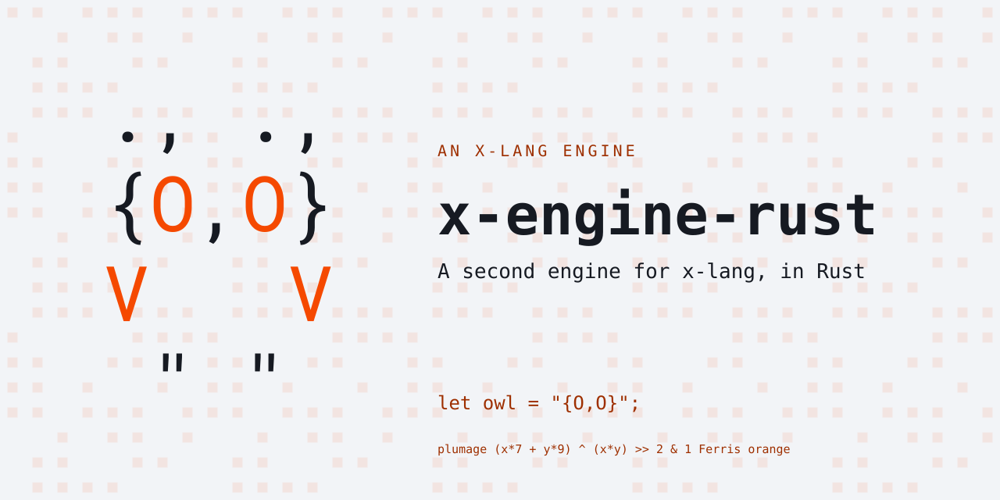
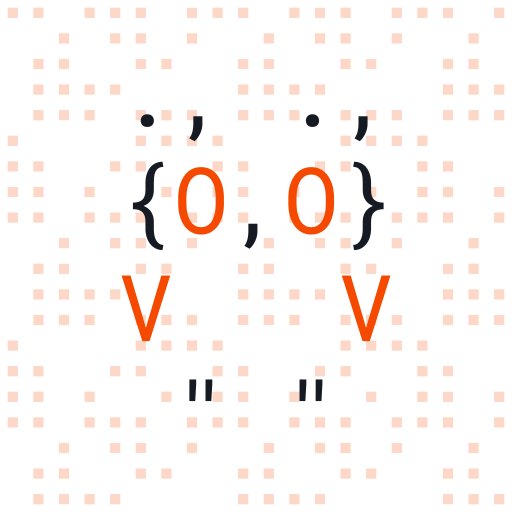

# x-engine-rust

<p align="center"></p>

A second engine for [x-lang](https://github.com/jonruttan/x-lang), in Rust.
[x-engine-c](https://github.com/jonruttan/x-engine-c) is the reference
engine; this one is held to the same
[engine contract](https://github.com/jonruttan/x-lang/blob/main/docs/engine-contract.md)
and judged by the same conformance suite, which lives in x-lang.

Its structure follows the reference's: one self-describing object tree that
behaviour comes from by walking. [ARCHITECTURE-PORT.md](ARCHITECTURE-PORT.md)
names each structure taken from the C engine.

The engine core forbids unsafe code. `unsafe_code = "forbid"` is the crate's
lint level, and `forbid` cannot be overridden by an inner `allow`, so the
foreign door — `dlopen`, calling through a machine address, syscalls, signal
dispositions — is a separate crate, `foreign/`, and the only place the
compiler permits `unsafe`.

## Status

Unreleased: the crate is at 0.0.1, there are no tags, and x-lang's engine pin
names x-engine-c.

x-lang's library boots on it: `lib/x-core.x`, the helium dialect and the
xenon dialect, as of the port of x-engine-c's surface through v0.2.31. The
whole of x-lang's spec suite has not been measured on this engine since that
port.

`x-engine.xon` is the engine's declaration, generated by x-lang's generator
from `tools/contract/isa.x` and `tools/contract/claims.x`:

- the `core`, `gc` and `posix` profiles;
- twenty-two capabilities, among them `isa/ffi-call`, `isa/syscall` and
  `native/jit`;
- four guarantees: `gc/explicit-only`, `gc/non-moving`,
  `int/ptr-same-width` and `eval/tco`.

Against x-engine-c's declaration it lacks the `full` profile, the
capabilities `instr/cov`, `instr/profile` and `tok/label`, and the
guarantees `err/typed-raise` and `str/nul-terminated`.

## With x-lang

Both of these run in an x-lang checkout, against a build of this engine:

```
X_ENGINE_DIR=../x-engine-rust sh tools/check/engine-contract.sh
make conformance X_BIN=../x-engine-rust/target/release/x-engine X_ENGINE_DIR=../x-engine-rust
```

The first asks whether the declaration provides what x-lang's library
requires; the second runs the conformance suite on the binary.

The binary is named `x-engine`, not `x-bin`. `claims.x` says so in a
`(binary …)` row, and x-lang's wrapper reads the name from there.

## The heap

The heap is a pinned arena of machine words (`src/heap.rs`). An object's
address is a real machine address into it, so 0 is never one and means nil,
and an object or a string's bytes cross to C as they are.

The arena only grows. `heap collect` marks and sweeps (`src/collect.rs`); a
freed object goes back on a free list keyed by its size and is handed out
again, and nothing is compacted. Those are the two heap guarantees:

- `gc/explicit-only`: nothing but `(heap collect)` collects. The
  `X_GC_STRESS` hook collects at other points on purpose, under test, so a
  missing root shows on the next form.
- `gc/non-moving`: every address x-lang holds stays valid for the run.

`call/cc` is re-entrant: a continuation invoked after its extent has ended
replays its control records (`src/eval.rs`).

## The contract files

`tools/contract/` holds this engine's description of itself, which x-lang
reads:

| file | holds |
|---|---|
| `isa.x` | every primitive the engine binds |
| `obj-layout.x` | the object header's layout |
| `base-paths.x` | the routes to the base's fields |
| `base-slots.x` | the positions in the base's slot vector |
| `claims.x` | the guarantees and the capabilities that cannot be derived |

## Rulings taken from the reference

Where x-lang's documents do not rule, x-engine-c's behaviour is the ruling:

- A top-level raise ends the run: the second form of
  `(error "a") (error "b")` never evaluates.
- The unbound-symbol text is `Unbound SYMBOL 'name`.
- `eq?` compares numbers by value and strings by identity: `(eq? 1 1)`
  holds, and `(eq? "a" "a")` does not.

## Building and checking

```
cargo build --release           # produces target/release/x-engine
sh check.sh                     # fmt, clippy (warnings are errors), unit tests
sh check.sh /path/to/x-lang     # ...and x-lang's conformance suite
```

The unit tests ask whether a primitive does what this engine intends; the
conformance suite asks whether that intent is x-lang's.

## Licence

MIT No Attribution (MIT-0). See [LICENSE](LICENSE).

<p align="center"></p>
